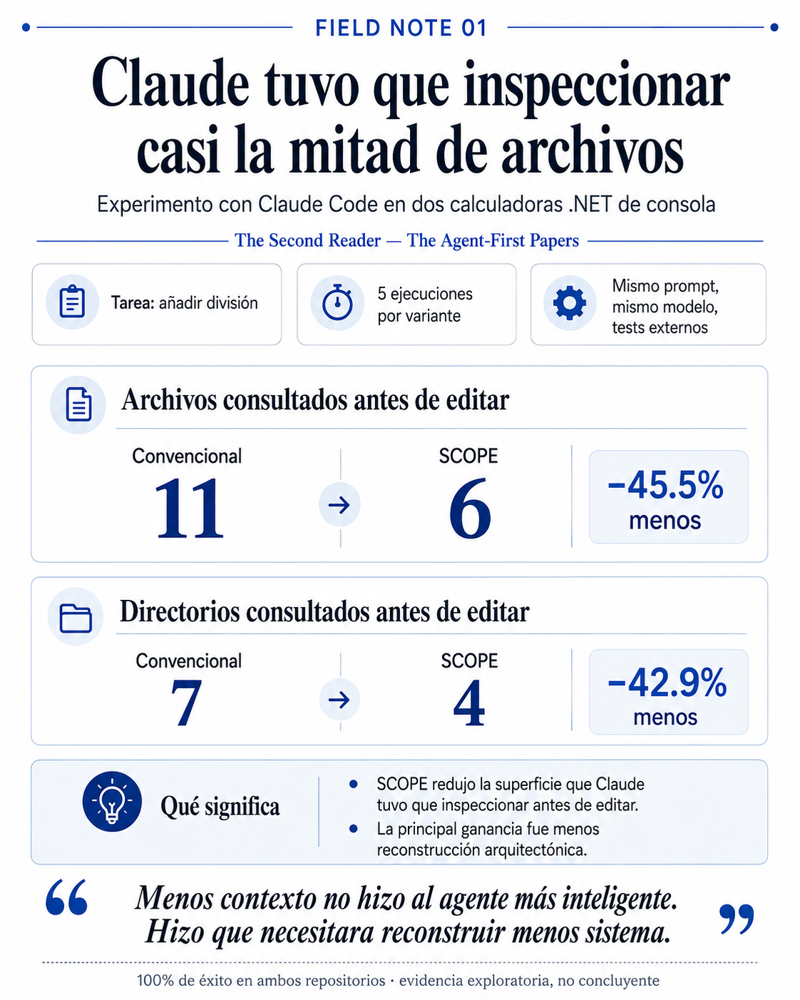

# Field Note 01 — Context locality

## Question

Does colocating context, implementation, and verification reduce the repository surface an agent needs to reconstruct before editing?

## Setup

Two .NET console calculators expose the same initial behavior: addition.

The **conventional** variant organizes the repository by technical layers: domain, application, factories, validation, tests, and global architecture documentation.

The **agent-first** variant organizes behavior around a capability boundary. Context, implementation, and tests for addition live together under `Features/Add/`.

Claude Code receives the same task in both variants:

> Add division. Let the user choose between addition and division. Division by zero must print `Cannot divide by zero.` without an unhandled exception. Preserve addition and add tests.

Protocol:

- same task;
- same model;
- same effort;
- fresh clone per run;
- no user skills, plugins, MCP servers, or browser tools;
- 5 runs per variant;
- external `dotnet test` after each run.

## Result

All 10 runs passed external validation.

| Median | Conventional | Agent-first | Reduction |
|---|---:|---:|---:|
| Total elapsed time | 62.89 s | 57.239 s | 9.0% |
| Time to first edit | 23.314 s | 22.283 s | 4.4% |
| Context operations before editing | 13 | 10 | 23.1% |
| Unique files consulted | 11 | 6 | 45.5% |
| Unique directories consulted | 7 | 4 | 42.9% |
| Agent `dotnet test` attempts | 1 | 1 | 0% |
| Cost | $0.244 | $0.210 | 14.0% |
| Files changed | 6 | 4 | 33.3% |
| Lines added | 82 | 113 | — |
| Lines deleted | 3 | 2 | — |

There was no overlap in the observed navigation ranges:

- files consulted, conventional: **10–12**;
- files consulted, agent-first: **5–7**;
- directories consulted, conventional: **6–7**;
- directories consulted, agent-first: **4–5**.

## Interpretation

The strongest signal was not speed. It was reconstruction surface.

The agent-first variant cut the median number of files inspected before editing from 11 to 6, while total elapsed time fell only 9%.

That suggests a narrower claim than “agent-first code makes agents faster”:

> **Local context can reduce how much architecture an agent needs to reconstruct before it can act.**

The agent-first variant also added more lines in the median run. Locality is not the same thing as less code. A capability may carry explicit context and explicit result types that increase line count while reducing search surface.

## What this does not prove

This is a tiny synthetic repository and five runs per variant. The result is exploratory, not statistically conclusive.

The two repository structures are not identical apart from context location, so the experiment does not isolate a single causal variable.

`stream-json` only exposes paths visible in tool calls. File and directory counts are lower bounds on what the model may have observed indirectly.

Human review time was not collected in the first published run set. That remains an important missing measurement because reducing agent navigation is only half the story; a useful architecture should also reduce the cost of establishing confidence in the result.

## Next test

Repeat the experiment in a repository with roughly 50 capabilities.

The hypothesis is not simply that the numbers improve. The question is whether the **fraction of the repository that must be reconstructed for a local change stays bounded as the repository grows**.

